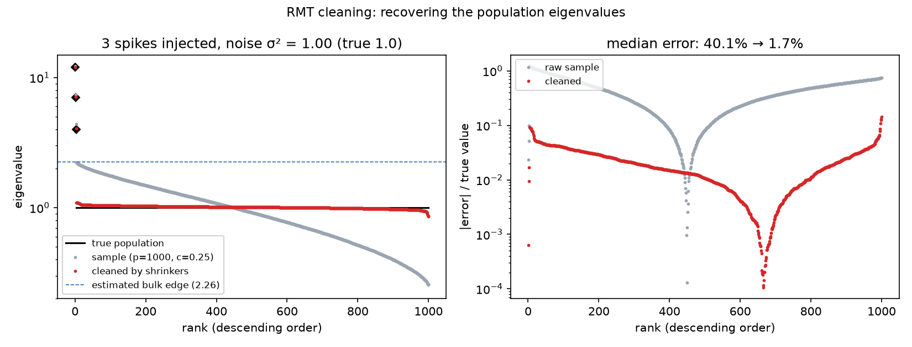
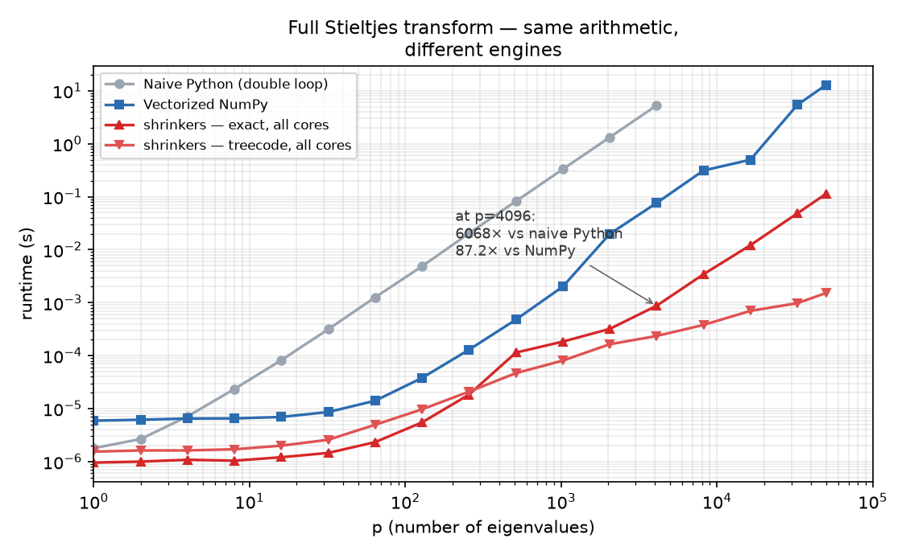
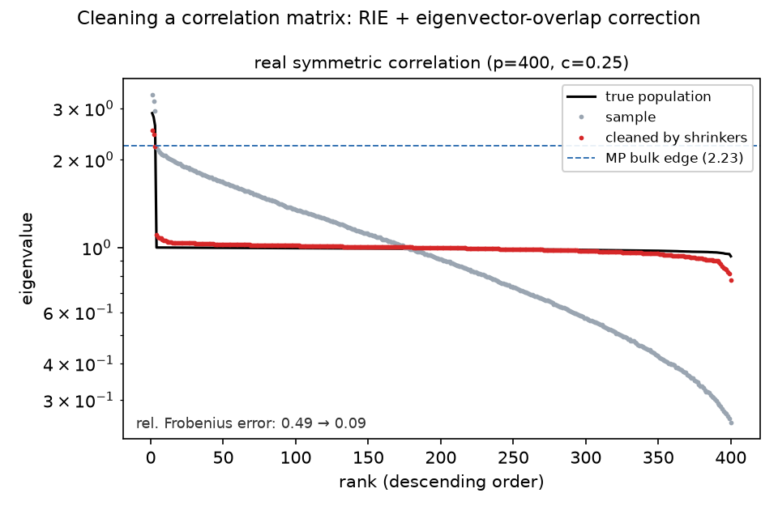

# shrinkers

[](https://github.com/alexisrosuel/shrinkers/actions/workflows/ci.yml)
[](https://github.com/alexisrosuel/shrinkers/blob/main/LICENSE)

**Fast RMT (Random Matrix Theory) Population Eigenvalue Estimation Kernel**

A fast Rust implementation of **spiked + bulk eigenvalue cleaning** via
free-probability deconvolution: detect spikes (BEMA — Bulk Eigenvalue
Matching Analysis), debias them with the inverse BBP map (the
Baik–Ben Arous–Péché phase transition), and deconvolve the bulk (El
Karoui). Features O(p log p)
ChebCode treecodes (Chebyshev interpolation) for the
Stieltjes transform, auto-vectorized loops,
cache blocking, multi-threaded kernels (**~6× on an 8-core machine**, one keyword away),
and PyO3 bindings.

## Install

```bash
uv pip install shrinkers        # or: uv add shrinkers
# pixi users:
pixi add --pypi shrinkers       # in a pixi.toml: [pypi-dependencies]
# plain pip works too
pip install shrinkers
```

Wheels are published for Linux (x86_64, aarch64) and macOS (arm64 —
Intel Macs are no longer served, build from the sdist); Windows and
other platforms build from the sdist with a Rust toolchain. To hack on
the crate itself, see [Development](#development).

## Why shrinkers?

**1 · It actually un-distorts the spectrum.** Sample eigenvalues of a
high-dimensional covariance are biased artifacts: the bulk is smeared over
`[(1−√c)², (1+√c)²]·σ²`, genuine spikes are compressed toward the edge.
`shrinkers` inverts that distortion and recovers the population spectrum:



*Spiked model, p = 1000, c = 0.25, σ² = 1, three spikes injected at 12 / 7 / 4.
All 3 spikes are detected and debiased to within 2 % (12.01 / 7.07 / 4.07),
the noise level is estimated at σ̂² = 1.002, and the median relative error
against the true population eigenvalues drops from **40 % to 1.7 %** in a
single call (`estimate_population_eigenvalues`). Each red point is the cleaned
value of the sample eigenvalue at the same rank — the estimator is a pointwise
map, so the ranks are not re-sorted.*

**2 · It is absurdly fast for what it computes.** Same math as your NumPy
one-liner, orders of magnitude faster — compared below against the two
baselines people actually write: a textbook pure-Python double loop, and a
vectorized NumPy version:



*Full transform of all p points, log-log over the whole 10⁰–10⁵ range,
η = 1/√p, Apple M1 Max, NumPy 2.5.1.*

| p | Naive Python | NumPy | shrinkers exact ¹ | shrinkers ChebCode ² |
|---|---|---|---|---|
| 1 024 | 0.33 s | 2.0 ms | **0.18 ms** · 11× | **0.081 ms** · 25× |
| 4 096 | 5.3 s | 76 ms | **0.87 ms** · 87× | **0.24 ms** · 320× |
| 50 000 | *(~13 min extrapolated)* | 12.9 s | **0.113 s** · 114× | **1.52 ms** · ≈8 500× |

¹ machine precision — the zero-error anchor.  ² `chebcode_fast` preset
(θ=1.0, n=8, leaf 32, four-lane f32 far field), rel. error ~2e-5: trading the
exact family's zero error for it buys **~74×** at p = 50 000, while the
`chebcode` (~5e-10) and `chebcode_xtreme` (~1e-12) presets cost 4–8× more
than `chebcode_fast` (see [docs/internals.md](docs/internals.md) and the
`[Unreleased]` CHANGELOG round for the full record). That round cut the Rust
evaluation by **~19 % sequentially** and **~23 % under Rayon** at p = 50 000
(4.41 → 3.59 ms / 0.72 → 0.55 ms), and the f64 presets remain bit-identical.
At microsecond scales
both shrinkers curves flatten onto their fixed Python-call overhead — a
Rayon request on tiny inputs runs sequential automatically rather than
paying the thread-pool floor (details in
[docs/internals.md](docs/internals.md)).
Every number is reproducible: `scripts/make_readme_figures.py`
regenerates all three figures end-to-end, and `docs/img/readme_figures.json`
holds the raw measurements.

Above the 50k frontier the treecode's per-query work still grows; the
coarse-grid NUFFT (`nufft`, selected by `auto` above p = 50 000; the
measured crossover is ~40k but the auto table keeps the noisy-tie 50k bin)
keeps the FFT grid at ≤65 536 cells and wins by 1.7–4×:

| p | ChebCodeFast | `nufft` | speed-up | rel. error |
|---|---|---|---|---|
| 100 000 | 3.5 ms | **2.0 ms** | 1.8× | ~2.7e-5 |
| 200 000 | 7.4 ms | **2.9 ms** | 2.5× | ~3.4e-5 |
| 1 000 000 | 34.6 ms | **8.5 ms** | 4.0× | ~5.1e-5 |

(Python-level, median of 3–5, η = 1/√p. The method caps the grid at 65 536
cells, so at very small η the error grows toward ~1e-4 while the speed
advantage remains; `chebcode_fast` stays the choice through the measured 50k bin.)

**3 · It uses every core you give it.** The exact kernel is data-parallel
across cache blocks — flip one argument (`parallel=True`) and the
same call spreads over your cores with no reduction step and no false
sharing. Measured with `examples/measure_runtime_audit.rs readme_par <p>`
(recorded `harness_spectrum`, η = 1/√p, median of 11):

| p | exact, 1 thread | exact, all cores | gain |
|---|---|---|---|
| 10 000 | 25.5 ms | 4.9 ms | **×5.2** |
| 50 000 | 638 ms | 117 ms | **×5.4** |

The all-cores times are unchanged by that exact-kernel round; the *ratios*
moved down only because the single-thread kernel got 15 % faster (interleaved
before/after in [docs/internals.md](docs/internals.md)).
`chebcode_fast` scales too — ×4.4 at p = 10 000 and ×6.5 at p = 50 000
(0.65 → 0.15 ms, 3.59 → 0.55 ms; measured with
`examples/measure_chebfast.rs compare`). Note also that the NumPy baseline in figure 2
is itself single-core — even pinned to one thread, shrinkers still wins
by roughly an order of magnitude (9.1× at p≈5000).

### What's inside

- `deconvolve_spiked(evals, c)` — the one-call pipeline: BEMA detection →
  inverse-BBP spike debiasing → El Karoui bulk deconvolution;
- Stieltjes-transform methods spanning the whole speed/accuracy frontier —
  machine-precision exact kernels, ChebCode treecodes (~2e-5 at the
  `chebcode_fast` speed point, ~6e-13 at `chebcode_xtreme`), a large-p
  coarse-grid NUFFT (`nufft`, ~2e-5…4e-5), HODLR — plus
  data-driven `speed_auto` / `accuracy_auto` picks, with
  `auto` = the measured speed policy (same Pareto table, resolved in one
  place for every entry point, and on the deconvolution grid the treecode is
  sized to the number of query points it actually serves);
- correlation-matrix cleaning with eigenvector-overlap correction — real
  symmetric — direct precision-matrix shrinkage, Ledoit–Wolf inverse nonlinear
  shrinkage (QIS/LIS/GIS) and full precision-matrix estimation, Tracy–Widom
  spike detection;
- Rust API + PyO3 bindings with the GIL released during computation;
- multi-core execution built in — exact and ChebCode kernels parallelize
  multi-core (`parallel=True`).

## Quickstart

The **core** of the crate is a single call that cleans the sample eigenvalues
under a spiked covariance model, recovering the population spectrum:

```python
import numpy as np
from shrinkers import deconvolve_spiked

# Sample spectrum of a spiked covariance: Marchenko-Pastur bulk
# (sigma^2 = 1, c = 0.25) plus three spikes at 12, 7 and 4, observed
# through n = p/c Gaussian samples.
p, c = 1000, 0.25
pop = np.concatenate([[12.0, 7.0, 4.0], np.ones(p - 3)])
y = np.random.standard_normal((p, round(p / c))) * np.sqrt(pop)[:, None]
evals = np.linalg.eigvalsh(y @ y.T / y.shape[1])     # ascending

res = deconvolve_spiked(evals, c=c)
print(res["k"])        # -> 3 spikes detected
print(res["spikes"])   # -> close to [12, 7, 4] (BBP-debiased)
print(res["bulk"]["lambda_grid"][:4],   # grid + deconvolved bulk density
      res["bulk"]["density"][:4])       # profile on a 200-point grid
```

## How it works (30-second version)

One call, three steps:

1. **Detect** — sample eigenvalues that escape the bulk edge are flagged as
   spikes (real signal, e.g. factors).
2. **Debias** — each spike is mapped back to its true population value,
   undoing the upward push that high-dimensional noise inflicts on large
   eigenvalues.
3. **Deconvolve** — spikes removed, the remaining bulk is inverted through
   the Marčenko–Pastur equation to recover the population density.

This is useful for factor-model selection, noise validation, signal
extraction, and covariance estimation when the noise is not i.i.d. white.
The math (Stieltjes transforms, BBP inverse, El Karoui inversion) lives in
[docs/internals.md](docs/internals.md).

## Python usage

```python
from shrinkers import deconvolve_spiked
import numpy as np

evals = np.array([0.5, 1.0, 2.0, 3.0, 5.0, 10.0], dtype=np.float64)

# Clean the sample eigenvalues (spiked + bulk deconvolution)
res = deconvolve_spiked(evals, c=0.3)
print(res["k"])                 # -> 1 detected spike
print(res["spikes"])            # -> [8.779] debiased population spike
                                #    (sample value was 10; BBP pulls it down)
print(res["bulk"]["density"].shape)     # -> (200,) deconvolved bulk density
```

### Cleaning a correlation matrix

`deconvolve_spiked` takes eigenvalues. When what you hold is the matrix,
`clean_correlation_matrix` does the whole job in one call — internal
eigendecomposition, RIE shrinkage, and reconstruction with the eigenvector
angular-overlap correction — and hands back the cleaned matrix together with
the eigensystem:

```python
from shrinkers import clean_correlation_matrix

C = np.corrcoef(X, rowvar=False)          # (p, p) sample correlation
res = clean_correlation_matrix(C, c=p / n)
print(res["eigenvalues"])                 # RIE-cleaned eigenvalues, descending
print(res["covariance"])                  # cleaned matrix, symmetric & PD
```

`clean_covariance_matrix` is the covariance-named twin on the *same* estimator:
the kernel only ever sees a spectrum and `c`, so the covariance/correlation
distinction lives entirely in the input matrix, and the two entry points differ
only in the scale of what they return. And because the reconstruction preserves
the trace but not the individual diagonal entries, `renormalize=True` restores
the exact unit-diagonal correlation contract:

```python
from shrinkers import clean_covariance_matrix, clean_correlation_matrix

res = clean_covariance_matrix(S, c=p / n)                    # covariance units
res = clean_correlation_matrix(C, c=p / n, renormalize=True) # diagonal == 1
```

Note that cleaning a covariance and then standardising it is *not* the same as
cleaning the correlation matrix directly: RIE commutes with orthogonal
conjugation but not with the diagonal congruence $D^{-1/2} S D^{-1/2}$, so the
correlation matrix has to be cleaned on its own spectrum.



*A real symmetric correlation matrix (p = 400, three factors, c = 0.25) against
its known population. The sample bulk is smeared across the Marchenko–Pastur
support (grey); cleaning collapses it back onto σ̂² ≈ 1 (red), and the relative
Frobenius error against the population correlation drops from **0.49 to 0.09**.
The pointwise RIE map also shrinks the large eigenvalues below their sample
values — debiasing spikes optimally is `estimate_population_eigenvalues`'s job,
not this one. Regenerated by `scripts/make_readme_figures.py`.*

### Precision matrices — estimating Σ⁻¹ directly

Inverting a shrinkage-cleaned covariance is **not optimal** for the inverse:
the covariance loss does not penalise errors on the inverse scale, so the small
inverted eigenvalues get over-inflated. `shrinkers` implements Ledoit & Wolf's
*inverse nonlinear shrinkage* (Bernoulli 2022), which derives the optimal
precision eigenvalues directly instead of inverting an optimal covariance:

```python
from shrinkers import inverse_nonlinear_shrinkage, estimate_precision_matrix

# Spectrum in, optimal precision eigenvalues out (default: QIS; also "lis"/"gis")
res = inverse_nonlinear_shrinkage(evals, c=0.25)
omega_evals = res["precision_eigenvalues"]

# Or the full matrix Ω̂ = U diag(ω) U′ from a sample covariance/correlation matrix
sample_cov = np.cov(data, rowvar=False)        # (p, p), data shape (n, p)
res = estimate_precision_matrix(sample_cov, c=0.25)
omega = res["precision"]                       # (p, p), symmetric
omega_evals = res["precision_eigenvalues"]     # paired with res["eigenvectors"]
```

`qis` targets the Frobenius / inverse-Stein / minimum-variance losses, `lis`
Stein's loss and `gis` the symmetrized Kullback–Leibler divergence. On a
p = 60 random model, QIS cuts the relative-Frobenius error on the precision
matrix from **0.57** (naive 1/λ) to **0.17**. The estimator reuses the crate's
Stieltjes kernels — θ and Hθ are the transform evaluated on the scaled ray
z_i = λ_i(1 + ih) — and matches the Ledoit–Wolf reference implementation to
machine precision (~5e-16).

See `docs/python_api.md` for the full API reference.

## Comparison with existing packages

The only other Python package implementing RIE shrinkage is **pyRMT** (PyPI). Our comparison (a one-off benchmark script, since removed from `scripts/`; the reference NumPy implementation lives in `scripts/rie_numpy.py`) reveals:

### 🐛 pyRMT has a critical bug

`pyRMT.stieltjes(z, E)` computes $\mathrm{tr}(zI - E)$ instead of the correct $\mathrm{tr}\bigl((zI - E)^{-1}\bigr)$ — the matrix inverse is missing. This makes its RIE shrinkage completely wrong (~360% relative error).

| Method | p=100, c=0.5 | p=500, c=0.5 |
|--------|-------------|-------------|
| `rie_numpy` (ref) | ✅ ground truth | ✅ ground truth |
| `shrinkers` (Rust autovec) | **1.2e-14** max diff | **4.4e-14** max diff |
| `shrinkers` (Rust, approximate kernel) | **9.5e-03** (0.15% error) | **3.0e-02** (0.16% error) |
| pyRMT (fixed, same η) | 3.3e-01 (2.5% error, η effect) | 6.2e-01 (1.7% error, η effect) |
| **pyRMT (original buggy)** | **❌ 1.7e+01 (358% error)** | **❌ 1.9e+01 (376% error)** |

Note: pyRMT uses $\eta = 1/\sqrt{p}$ vs our $0.1/\sqrt{p}$. When using the same η, both give identical results up to machine precision. The γ bias correction in pyRMT's `optimalShrinkage` has negligible effect at moderate p.

### Performance vs pyRMT

> Note: the earlier `stieltjes_transform` / RIE entry point has been replaced
> by `deconvolve_spiked` (spiked + bulk deconvolution). This table is the
> historical 0.1.0 comparison campaign: the `shrinkers` row is that
> measurement, retained so the ratios against `rie_numpy` / pyRMT stay on one
> footing. The current numbers are the table under *"It is absurdly fast"*
> above — the `[Unreleased]` `chebcode_fast` retune made this path 2.2–2.5×
> faster again at equal deconvolution quality, so the row below understates
> it.

| Method | p=100 | p=500 | p=1000 | Scaling |
|--------|-------|-------|--------|---------|
| **`shrinkers` deconvolve_spiked** (0.1.0) | **9.4 µs** | **33.2 µs** | **63.2 µs** | O(p²) |
| `rie_numpy` (pure NumPy) | 60 µs | 1337 µs | 5381 µs | O(p²) |
| pyRMT (fixed, loop-based) | 1164 µs | 2695 µs | 6642 µs | O(p²) |
| **pyRMT (original buggy)** | **928 000 µs** | **1 474 000 µs** | — | **O(p³)** |

Key findings:
- **`shrinkers` is 6–80× faster than `rie_numpy`** and **~100–120× faster than pyRMT (fixed)** at p=100
- The **buggy pyRMT is O(p³)**: 928 ms at p=100, making it unusable beyond tiny dimensions
- Below the measured small-p crossover (~p≤400 single-core for the retuned
  `chebcode_fast`, ~p≤500 for `chebcode`), the exact O(p²) kernels are the
  fastest pick; ChebCode takes over beyond
  ([docs/internals.md](docs/internals.md))

## Documentation

- [`docs/python_api.md`](docs/python_api.md) — full Python API reference;
- [`docs/internals.md`](docs/internals.md) — method map, algorithm math, the
  complete benchmark record and the unsafe-code policy;
- [`docs/hardware_optimizations.md`](docs/hardware_optimizations.md) —
  every machine-facing optimization (SIMD refined reciprocal, register
  tiles, cache blocking, layout) with the measured negatives kept;
- [`docs/chebcode_algorithms.md`](docs/chebcode_algorithms.md) — deep dive
  into the ChebCode* treecodes (tree layout, Chebyshev equivalent
  densities, traversal, presets, measured parameter sensitivities);
- [`docs/nufft_algorithms.md`](docs/nufft_algorithms.md) — deep dive into
  the coarse-grid NUFFT (grid sizing, packed FFT convolution, padding,
  parallel transfer, measured accuracy/speed);
- [`CHANGELOG.md`](CHANGELOG.md) — release history and known caveats.

## Development

The project is managed with **pixi** (conda-forge) for the Python environment and
**Cargo** for the Rust crate. The Python extension is built with **maturin** (PyO3).

### Toolchain

| Tool | Purpose | Managed by |
|------|---------|-----------|
| Rust (stable) | Core SIMD kernel | rustup |
| Cargo | Rust build/bench/test | rustup |
| pixi | Python env + tasks | pixi |
| Python 3.14 | Python bindings & scripts | pixi |
| maturin | PyO3 extension build | pixi |
| numpy / scipy / matplotlib | Python numerics & plotting | pixi |
| pytest / ruff / mypy | Python test, lint, type-check | pixi |

### Setup

```bash
# Create the pixi environment (installs Python, numpy, scipy, maturin, dev tools)
pixi install

# Build the Rust extension into the pixi env (release)
pixi run build
```

### Common tasks (via pixi)

```bash
pixi run build          # maturin develop --release
pixi run build-debug    # maturin develop (debug)
pixi run test           # cargo test
pixi run test-py        # pytest tests (Python API tests; run `pixi run build` first)
pixi run lint           # cargo clippy --all-targets -- -D warnings
pixi run lint-py        # ruff check scripts tests
pixi run fmt            # cargo fmt
pixi run fmt-check      # cargo fmt --check
pixi run type-py        # mypy scripts tests
pixi run bench-stieltjes  # python scripts/bench_stieltjes.py
pixi run measure        # python scripts/measure_current.py
```

### Rust benchmarks

```bash
cargo bench --bench pipeline_methods_overview  # every method end-to-end (p=500/1000)
cargo bench --bench pipeline_config_sweep      # knob-by-knob comparison at p=1000
cargo bench --bench pipeline_cache_scaling     # blocked vs tiled as output outgrows cache
cargo bench --bench kernel_tiled_blocksize     # raw tiled kernel + block-size landscape
```

## License

MIT