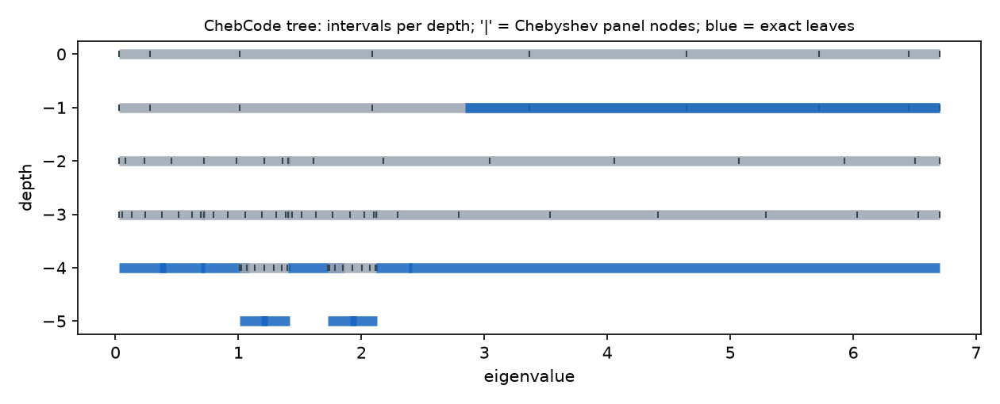
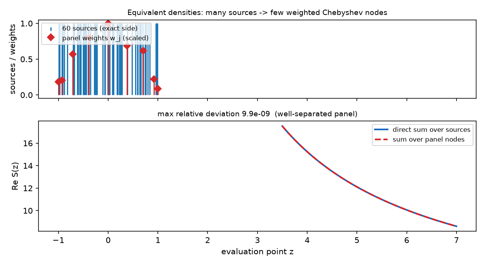
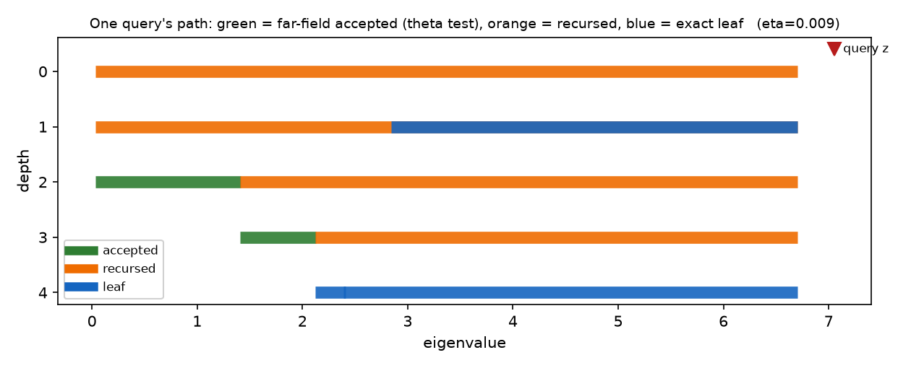
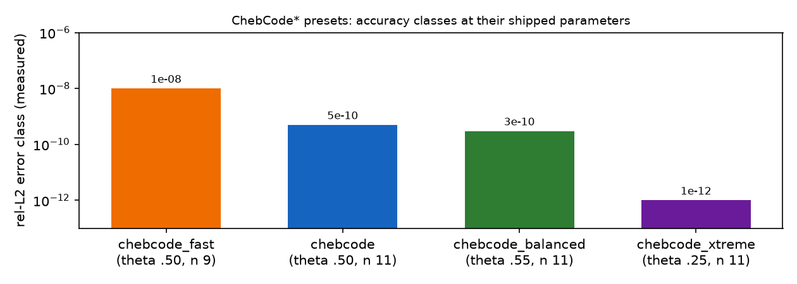

# The ChebCode* family: algorithm reference

`ChebCode`, `ChebCodeFast`, `ChebCodeBalanced` and `ChebCodeXtreme` share
one implementation — a Chebyshev-interpolation treecode over the sorted
eigenvalue set (`src/stieltjes/chebcode.rs`). They are the least trivial
methods in the crate and also the ones every fast code path ends up using,
so this document records how they actually work. Everything below is
described as implemented; measured numbers trace to the referenced files.

## Problem

All evaluation paths reduce to

    S(x_k) = Σ_j 1 / ((x_k − λ_j) − iη),      k = 1..Q

where `p` is the number of (sample) eigenvalues λ_j, `i` the imaginary
unit, and η the regularization offset — an imaginary shift keeping every
denominator nonzero; the library default is η = 0.1/√p
(see [`eta_choice.md`](eta_choice.md)). `Q` is the number of query points:
with Q = p when cleaning eigenvalues (`rie_shrinkage`) and Q = n_points
(default 200) on the deconvolution grid (`compute_stieltjes_at_points`).
Direct summation is O(p·Q). The treecode makes both large cases
O((p + Q) log p).

## Tree layout

Sources are sorted ascending (skipped defensively if already sorted — an
O(p) check against an O(p log p) sort; the pipeline always passes sorted
input). A balanced binary tree is then built recursively:

* a node covers a value interval `[lo, hi]` and a contiguous source range
  `[lo_idx, hi_idx)` into the sorted array;
* splitting happens at the **midpoint of the value interval**
  (`partition_point` on the sorted range), not the median of counts —
  children get geometrically balanced intervals, which is what keeps the
  opening-angle test meaningful (the test compares a node's half-width
  against θ × its distance to the query); degenerate splits fall back to
  the index midpoint;
* recursion stops when a node holds ≤ `leaf_cap` sources (leaves carry
  their sources exactly);
* nodes are numbered in **pre-order**, so an internal node's left child is
  always `node + 1`. Only the right-child link is stored (`-1` marks a
  leaf): the traversal loads one child index and one leaf flag per node
  instead of two pointers;
* everything lives in flat vectors, not pointer-chasing nodes. The
  precision path keeps structure-of-arrays metadata; the speed path keeps a
  separate compact 24-byte `NodeF32` record plus 64-byte interleaved panels
  (below).

Depth is ⌈log₂(p / leaf_cap)⌉ ≈ 11 levels at p = 50 000 with leaf_cap 32.

## Equivalent densities on Chebyshev panels

Every node owns `n` Chebyshev nodes of the second kind mapped onto its
interval, `t_j = c + l·s_j` with `(c, l)` the interval center/half-width
and `s_j ∈ [−1, 1]` the shared node template (built once per tree). On
each panel, the sources of that panel are replaced by **equivalent
densities** `w_j`: the unique set of weights such that the rational

    F(z) = Σ_j w_j / (z − t_j)

reproduces the kernel sum at every source location of the panel — the
barycentric Lagrange row-update. For each panel source `x_s`:

    v_j = β_j / (x_s − t_j),   w_j += v_j · (Σ_i v_i)⁻¹,

where `β_j = (−1)^j` (halved at the endpoints) are the barycentric
weights — distinct from the eigenvalues λ_j of the Problem section. If
`x_s` hits a node exactly, that single weight absorbs the mass.

The figure computes the real construction (same normalized barycentric
row update) for 60 sources on one panel, evaluating only where the θ
test (opening angle, defined in [Traversal](#traversal)) would accept it — see `scripts/make_chebcode_figures.py` for the exact
computation behind the printed deviation.

### Build: topology, then weights

The build is split into three phases so the expensive part can be
parallelized safely:

1. **Topology** (serial, recursive): append each node's interval, source
   range, right-child link and `n` Chebyshev positions. No weights are
   computed yet.
2. **Leaf fills** (independent, optionally Rayon-parallel): each leaf
   accumulates its sources with the row update above. Leaves write
   disjoint `n`-element slices of the weight array and only read the
   topology, so this needs no locks. Rayon jobs own groups of 32 panels to
   amortize scheduling.
3. **Parent merges** (serial, flat reverse-index sweep): node indices are
   pre-order, so every child has a larger index than its parent. Iterating
   `node_count-1 … 0` is therefore a valid bottom-up order; a parent's
   weights are composed from its two children's already-finished weights
   (`merge_all_weights`). Each child node acts as a mass `w_t` in the parent's
   barycentric row update, giving O(n²) work per child instead of
   O(count·n). This replaces the earlier recursive post-order merge with
   the same arithmetic and the same order within each merge.

Measured share of end-to-end runtime: **~15 %** for `chebcode_fast` at
p = 50 000 (build ≈ 0.6 ms with parallel leaf fills, eval ≈ 3.5 ms
sequential / 0.5 ms Rayon). Parallel leaf fills alone take the build from
≈ 0.80 ms to ≈ 0.63 ms at p = 50 000 (p = 10 000: 0.27 → 0.20 ms); below
~1 000 nodes they are disabled because Rayon scheduling exceeds the work.

## Traversal

Per query point `z = x − iη` (x is z's real part), a stack-based DFS
visits nodes; three cases. Notation used below, defined here once:

* `hw ≡ (hi − lo)/2` — a node's half-width;
* `cl ≡ max(lo − x, x − hi, 0)` — the *clamped* distance from the query's
  real part to the node interval (zero inside it), computed branchlessly;
* `θ ∈ (0, 1)` — the **opening angle**: the acceptance knob of the whole
  family. A node is "well separated" iff `hw² < θ²·(cl² + η²)`; larger θ
  accepts panels farther away ⇒ fewer recursions ⇒ faster and less
  accurate. Each preset ships its own θ; the build stores
  `accept_hw = hw²/θ²` per node so the per-visit test is one compare
  against `cl² + η²`.

1. **leaf** — exact pairwise sum over its sources with the SIMD two-lane
   helper (`F64x2`, refined Newton–Raphson reciprocal because AArch64 has
   no FP64 vector divide; see `stieltjes::simd`). Same lane layout as the
   far-field loop.
2. **internal, well-separated** — accepted ⇒ far-field contribution

        Re += Σ_j w_j·(z − t_j)/((z − t_j)² + η²),
        Im += Σ_j w_j·η/((z − t_j)² + η²),

   evaluated **term-by-term** on the panel's `n` nodes.
3. **not separated** — recurse into children.

The result is returned in the caller's original order although the tree is
built on the sorted multiset.

### The f32 speed path (`ChebCodeFast`)

The fast preset keeps the same tree and traversal but changes what the
branchy parts touch and how the far field is evaluated:

* each node is a 24-byte `NodeF32` (`lo`, `hi`, `accept_hw`, source range,
  right child). Traversal, the distance test and the acceptance test run in
  f32; leaves and final sums stay f64;
* each accepted panel's `n` nodes and `n` weights are adjacent (64 bytes
  for n = 8), so one accepted panel touches one cache line instead of one
  line in each of two arrays;
* the far field uses four-lane `F32x4` with a **one-refinement-step**
  reciprocal (`FRECPE` + one `FRECPS`, ~16 bits) — the interpolation
  already carries ~1e-5 relative error, so full f32 rounding is
  unnecessary. Panel partials accumulate in `F32x4` registers and are
  folded into f64 once per query;
* `η` is factored out of the imaginary accumulation: per node we form
  `q = w·inv`, then `Re += q·d`, `Im_N += q`, with a single `η·Im_N` at the
  end. This removes one multiply per term;
* panels that do **not** contain the query use an opening angle of
  `1.3·θ` (`OUTSIDE_THETA2 = 1.69`). Only panels containing the pole are
  accuracy-critical; on MP, log-spaced and clustered spectra at
  p = 5k…50k this removes ~10 % of accepted panels while keeping the
  worst-case error at the θ = 1 level (~2e-5). Larger multipliers buy
  little more time and start moving the error, so the factor is a
  constant, not a preset knob.

Why per-term evaluation rather than polynomial coefficients + a single
Horner division? Monomial coefficients of degree-n polynomials whose roots
cluster near ±1 amplify rounding catastrophically (measured relative
errors of 10²–10³), while this dot product evaluates every denominator
exactly like the leaf loop — unconditional stability.

## Complexity

Per query: O(log p) levels × O(accepted panels × n) far-field work +
O(leaf_cap) near-field work. With θ = 0.5 roughly half the angular
neighborhood is accepted at each level, giving the observed
O((p + Q)·log p)-class scaling.

Measured on M1 Max, p = 50 000, η = 1/√p, MP spectrum, against the exact
O(p²) reference:

| path | sequential | Rayon | rel-L2 |
|---|---|---|---|
| `chebcode_fast` eval only | **3.6 ms** | **0.55 ms** | ~2.5e-5 |
| `chebcode_fast` end-to-end | **4.5 ms** | **1.3–1.4 ms** | ~2.5e-5 |
| `chebcode` (DEFAULT) eval only | ~10.7 ms | ~1.6 ms | ~5e-10 |

The `[Unreleased]` kernel pass moved these from 4.41 ms / 0.72 ms / 1.79 ms
(FAST eval seq / eval Rayon / end-to-end Rayon, 9-run medians) and left the
f64 path bit-identical (same checksum) while making it ~8 % faster.

## Presets

| method | θ | n | leaf_cap | error class | note |
|---|---|---|---|---|---|
| `chebcode` | 0.50 | 11 | 32 | ~5e-10 | dispatch default preset |
| `chebcode_fast` (`chebf`) | 1.00 | 8 | 32 | ~1e-5 … 2e-5 (f32 far field) | fastest through p = 50k; `nufft` takes over above |
| `chebcode_balanced` (`chebb`) | 0.55 | 11 | 32 | ~3e-10 | FAST+6 % runtime |
| `chebcode_xtreme` (`chebx`) | 0.25 | 11 | 16 | ~1e-12/13 | precision niche |

The `chebcode_fast` point now sits at a ~2e-5 error class (worst measured
over MP / log-spaced / clustered spectra at p = 5k, 20k and 50k: 2.1e-5).
The speed comes from six compounding changes: the compact f32 node/panel
layout, one-step f32 reciprocal, f32 partial accumulation, `η` factoring,
the wider outside-θ rule and pre-order child links.

Parameter sensitivity, measured with
`examples/measure_cheb_sweep.rs` (interleaved A/B, error vs the exact
kernel):

* raising θ trades accuracy for fewer near-field recursions — θ = 0.55
  with n = 9 gains 4–7 % but showed a bad-seed tail (rel error 2.5e-7 on
  one seed at p = 10⁴ vs 8.5e-9 median over six seeds), breaking FAST's
  documented class; the same θ with n = 11 is rock-stable across seeds
  and became `Balanced`;
* lowering θ or shrinking leaf_cap costs time without accuracy benefit
  in the tested range; larger leaf caps lose time to longer exact loops.

## η coupling and stability

η appears twice: in the leaf/far-field denominators and inside the
separation test (`d² = cl² + η²`). Consequences:

* runtime is essentially η-independent (measured flat in
  `docs/eta_choice.md`);
* very small η pushes the separation boundary outward and sharpens the
  near-field denominators — the reason the library default is
  0.1/√p (see `docs/eta_choice.md` for the full analysis);
* near-degenerate eigenvalues (gaps down to 1e-11 were observed in tests)
  stay exact when they land in leaves, because leaves sum their own
  sources directly.

## Batch API and parallelism

`ChebCodeBatch::build(eigenvalues, theta, n, leaf_cap)` builds the tree
once; `evaluate_points(&points, eta, parallel)` serves any number of
queries from it — this is what makes the deconvolution grid cheap after
one construction, and what benchmarks use to separate build from
evaluation. Parallel mode chunks queries into blocks of **128** (measured
faster than 256 at p = 50k with the f32 path; plateau 64…1024): each task
reuses one stack buffer across consecutive queries, which keeps cache
warmth high because adjacent sorted values traverse nearly identical paths.

The dispatcher's parallel branches also request the parallel tree build
(`build_mode_parallel`), while public batch constructors stay sequential
so building a tree never spawns threads behind the caller's back. The
grid path (`compute_stieltjes_at_points`) uses the parallel build when the
caller asked for parallelism. Below `MIN_PARALLEL_QUERIES = 2048` a
parallel evaluation request runs sequentially anyway: the Rayon join costs
more than the whole call at the default `nq = 200` grid (0.037 ms parallel
vs 0.021 ms sequential at p = 50 000).

## Where it is used

* `rie_shrinkage` / `shrink_eigenvalues` — transform evaluated at the
  eigenvalues themselves;
* `deconvolve_spiked` / `spectral_deconvolution` — grid evaluation through
  `compute_stieltjes_at_points`, which routes the whole ChebCode family to
  tree-once/evaluate-many (before that routing existed, the family fell
  back to an O(p²) scalar sweep **per grid point**, making the spiked
  pipeline quadratic despite selecting a treecode);
* Python aliases: `"chebcode"`, `"chebcode_fast"`/`"chebf"`,
  `"chebcode_balanced"`/`"chebb"`, `"chebcode_xtreme"`/`"chebx"`.

Reproduce the measurements: `examples/measure_chebfast.rs`,
`measure_cheb_sweep.rs`, `measure_build_share.rs`; frontier data under
`docs/pareto/`.
